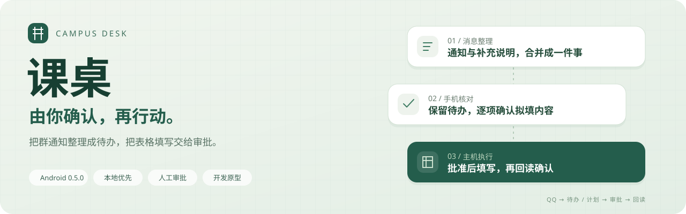
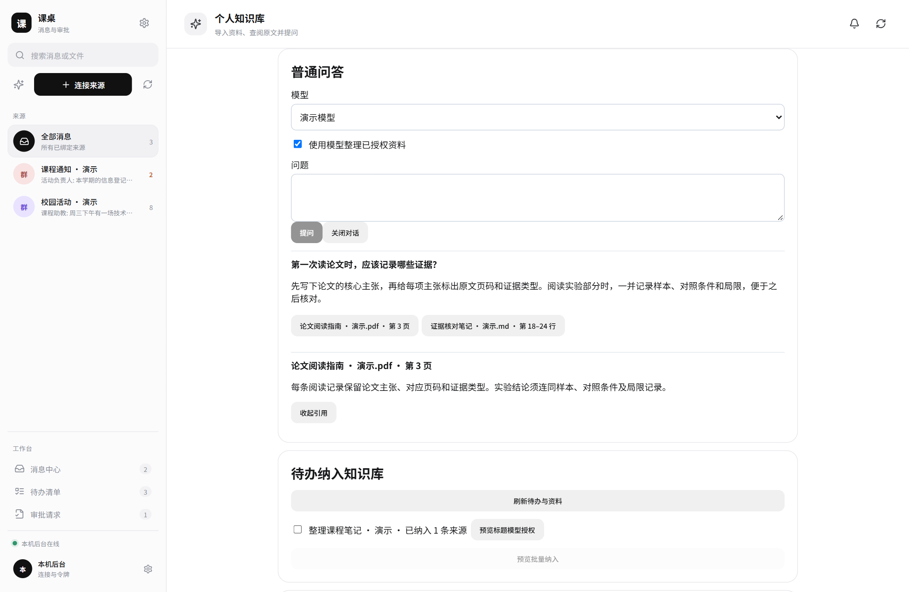
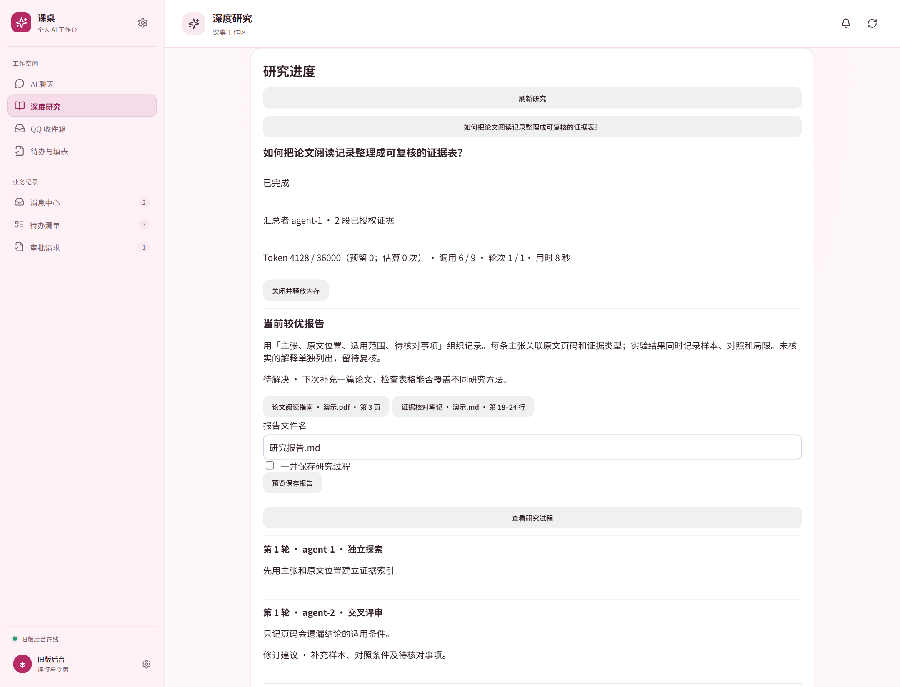
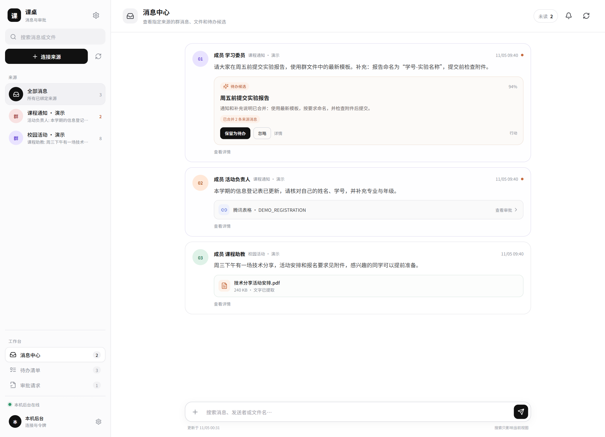
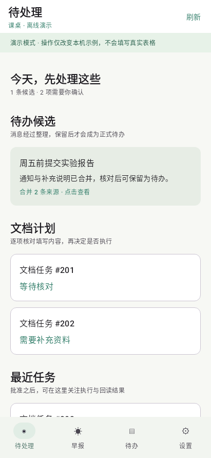
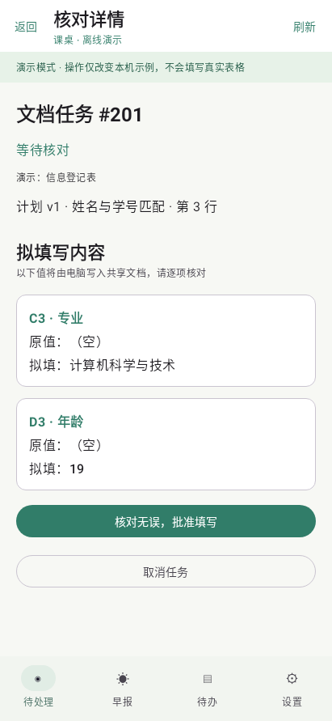
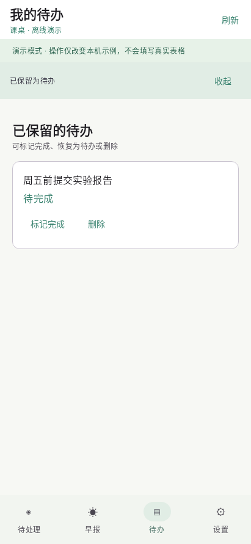
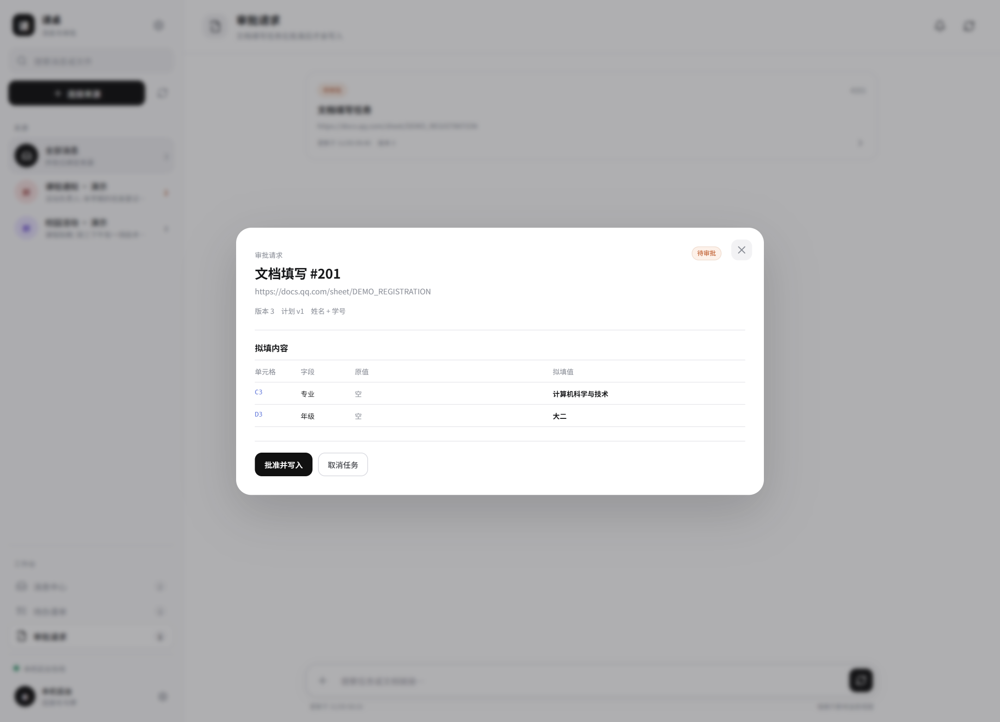
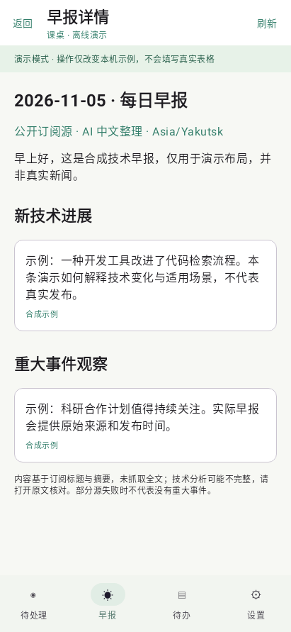
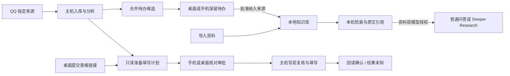

<p align="center">
  
</p>

<p align="center">
  <strong>简体中文</strong> · <a href="README_EN.md">English</a>
</p>

<p align="center">
  <strong>把校园消息变成待办，用个人资料回答问题。</strong><br>
  在桌面整理知识与开展研究，在桌面或手机核对并批准填表计划。
</p>

<p align="center">
  <a href="#界面预览">界面预览</a> ·
  <a href="#核心能力">核心能力</a> ·
  <a href="#快速开始">快速开始</a> ·
  <a href="#更新记录">更新记录</a> ·
  <a href="#验证与限制">验证与限制</a> ·
  <a href="#目录与文档">文档</a>
</p>

**课桌（Campus Desk）** 是面向个人的校园助手。从指定 QQ 消息整理待办，为腾讯在线表格准备填写计划，并通过 Android 或桌面核对和审批。桌面还提供可引用原文的本地知识库，以及多 Agent 的 **Deeper Research** 工作台。

本机工作区可独立使用知识库。日常初始化、资料导入和启动通过 Python 命令完成，QQ、填表和早报可按需启用。

当前为 **单用户、单主机的开发原型**，主要在 Windows 上验证。Android 已实现至 **0.5.0**；金山文档处于可行性分析阶段。

## 界面预览

### 桌面知识库与 Deeper Research

普通问答可打开引用，核对原文片段及页码或行号。



Deeper Research 展示已用预算、当前较优报告和 Agent 评审过程。



### 电脑整理消息，手机决定行动

实际桌面前端中的消息中心：原始通知、附件、合并候选和文档审批入口集中展示。



### 从待处理，到逐项核对，再到自己的待办

<table>
  <tr>
    <th width="33%">待处理</th>
    <th width="33%">填写计划审批</th>
    <th width="33%">我的待办</th>
  </tr>
  <tr>
    <td></td>
    <td></td>
    <td></td>
  </tr>
  <tr>
    <td align="center">合并相关通知，保留值得做的事</td>
    <td align="center">先看清改哪里、填什么，再批准</td>
    <td align="center">完成、恢复、二次确认删除</td>
  </tr>
</table>

<details>
<summary><strong>查看桌面审批界面与手机技术早报</strong></summary>

<br>


<p align="center">
  
</p>

</details>

<sub>截图均使用合成数据。桌面图来自实际 React 界面；Android 图来自实际 Compose 界面的 Robolectric 渲染，不是真机截图。图片不作为真实平台写入或后台通知的验收证据。[配图来源与复现](docs/images/readme/README.md)</sub>

## 核心能力

| 桌面能力            | 使用方式                                                                       |
| --------------- | -------------------------------------------------------------------------- |
| 个人知识库           | 导入 Markdown、TXT、DOCX、PDF、PNG 和 JPEG。文本、扫描页和图片可在本机解析，检索结果可打开原文片段及页码、段落或行号。  |
| 普通问答            | 用自然语言检索笔记和个人资料。为指定资料授予模型处理权限后，可让模型结合命中片段整理带引用的回答。                          |
| 待办与资料联动         | 保留待办时可一并审批纳入来源，也可批量纳入已有待办。完成或删除后，相关来源退出检索。批准更新个人资料后，受影响的旧填表计划会重新准备并等待审批。   |
| Deeper Research | 配置 2–4 位 Agent，各自分析、交叉评审、修订并比较结果。可限制 token、调用次数、轮数和有效运行时间，也可暂停、继续、取消或补充要求。 |
| 工作区填表与模型工具 | 在桌面提交腾讯表格链接来准备填写计划。普通问答可显式启用工具，查询获授权资料并准备本轮指定的表格。填写仍通过原有审批。 |

研究在主机进程中运行，关闭桌面窗口后可重新连接查看进度。保存报告前会展示写入预览；主机退出时释放未保存的研究记录。

| 消息整理                     | 个人待办                | 审批填写                   |
| ------------------------ | ------------------- | ---------------------- |
| 指定 QQ 群、成员或好友，按稳定账号标识过滤  | 合并同一事务的多条通知，保留或忽略候选 | 读取腾讯表格，定位本人行，准备单元格修改计划 |
| PDF / DOCX 文字提取，图片本地 OCR | 手机完成、恢复、确认删除        | 缺资料先询问，展示原值和拟填值，再人工批准  |
| 保留原始消息与来源，方便回看           | 技术早报、来源链接与定时设置      | 电脑写前复核、写后回读，结果未知时不自动重写 |


## 工作流程



保留待办不等于批准填写。写入开始后结果不明时进入 `outcome_unknown`，先核对，不自动重写。

## 快速开始

### 环境要求

- 工作区命令需要 **Python 3.11+**。Node.js 24 和 npm 用于现有后端及桌面构建。知识库适配器验证版本为 **Node.js 24.22.2 / SQLite 3.53.4**。真实腾讯表格执行使用 Microsoft Edge。
- 桌面 Web：根目录和 `desktop/` 各自的 npm 依赖。构建 Tauri 壳另需 Rust MSVC 工具链和 WebView2。
- Android：JDK 21、Android SDK 36；内嵌传输重建另需 Go 工具链及 NDK，版本见构建脚本和 `mobile/tsnet-probe/go/go.mod`。
- 真实业务：自行配置 QQ / NapCat、腾讯文档专用登录会话、本人资料和 DeepSeek API 访问。手机私网连接另需 Tailscale 配置与设备配对。

仓库不包含账号、数据库、浏览器会话、第三方 QQ 适配器安装包或预构建 APK/AAR。当前部分脚本仍带本机工具路径，换机需调整，尚未实现一键部署。

### 安装依赖与检查

在仓库根目录运行：

```powershell
npm ci
npm --prefix desktop ci
npm test
npm run desktop:build
```

前两条按锁文件安装后端和桌面依赖；`npm test` 运行后端测试，最后一条检查桌面 TypeScript 并生成 Web 构建。`npm ci` 会重建对应目录的 `node_modules`，不初始化真实账号，不填写在线表格。

### 使用桌面知识库与研究

已有知识库可直接供 Python 工作台检索。新工作区可用 `python -m campusdesk init-knowledge` 初始化，再用 `python -m campusdesk import-knowledge <文件>` 预览导入，核对后加 `--approve <摘要>` 发布。

```powershell
python -m venv .venv
.\.venv\Scripts\python.exe -m pip install -r requirements.txt
.\tools\start-python-workbench.ps1 -CopyToken
```

前两条创建隔离 Python 环境并安装依赖，第三条启动回环工作台。首次连接时，在桌面「个人知识库」粘贴 `-CopyToken` 复制的令牌。模型读取主机的 DeepSeek 配置和环境变量，先用 `python -m campusdesk knowledge-cloud <资料ID> allow` 或旧版资料管理审批对应资料的云端处理权限。

QQ、手工填表和旧版资料管理从「旧版资料管理与工具」进入，按[合并启动说明](docs/setup.md#桌面知识库)独立启动原服务。

### 配置真实业务后启动

首次使用需完成独立账号、资料和会话配置，参阅 [运行与连接说明](docs/setup.md)。

主机配置位于 `.private/config.json`，资料与任务位于 `.private/poc.sqlite`。先确认来源、账号、`pipeline=v2`、`messageCenter=true`，在接入与登录检查期间保持 `execute=false`。DeepSeek 相关功能读取主机进程环境变量 `DEEPSEEK_API_KEY`；仅创建 `.env` 文件不会自动加载它。

首次配置不预置任何真实表格地址，需在本机配置中指定自己获授权的测试表。

```powershell
npm start
```

启动本机 `127.0.0.1:9087` 主服务，窗口需保持打开。它会初始化/迁移本地数据库并按当前配置启动 worker；已有配置可能启用执行并保留获批准的任务，启动前应核对配置与任务，不能把启动当作只读检查。

另开窗口启动桌面开发界面：

```powershell
npm run desktop:dev
```

访问 `http://127.0.0.1:5173`，按界面配置连接。NapCat 和手机网关需要分别准备和启动；查看 [运行与连接说明](docs/setup.md)，不要重复启动占用同一端口的实例。

### Android 构建

```powershell
.\tools\build-android.ps1
```

该脚本运行手机端测试、lint 和 debug APK 构建，产物位于 `mobile/android/app/build/outputs/apk/debug/`。换机时用 `-JavaHome`、`-AndroidSdk`、`-GradleCache` 指定工具目录。缺失或过期的 AAR 会触发 Go 桥接库重建；首次需要下载依赖，Gradle 离线模式不代表 Go 依赖已缓存。

完整步骤见 [Android 运行说明](mobile/android/README.md)。当前原生库构建目标为 arm64，debug APK 仅供测试，release 尚未配置正式发布签名。

## 验证与限制

- 当前是单用户、单主机的 Windows 开发原型；文档填写已实现腾讯表格，金山/WPS、飞书和微信接入尚未实现。
- Deeper Research 当前使用获授权的知识库片段。模型协作、预算控制和窗口重连已用合成资料验证；联网取证和不同 effort 的效果对比处于后续阶段。
- 手机通知依赖后台轮询，进程被清理后的恢复和全天可靠性仍待完善。
- 复杂表格、部署范围与恢复能力仍有边界，见 [详细验证与限制](docs/validation-and-data.md)。

## 数据与凭据

- 账号、资料、附件和会话保存在本机 `.private/`，不随源码提供；密钥和平台登录需自行配置。
- 图片和扫描页 OCR 在本机执行。知识库在获得文件或目录的模型处理授权后，才会把相关片段发送到所选模型；原有消息分析、填表字段映射和早报仍按各自配置使用模型。
- GitHub 不备份被忽略的私人数据，需单独保存；详见 [数据与凭据说明](docs/validation-and-data.md#数据与凭据)。

## 目录与文档

```text
campusdesk/             Python 工作区、迁移、消息准入和模型工具规则
src/                    主机 API、知识库、研究编排、消息与填表
mobile/android/         Android 原生客户端与测试
mobile/tsnet-probe/go/   共享用户态私网桥接库源码
desktop/                Web 工作台和 Tauri 壳
test/                   后端自动测试
tools/                  构建、运行和诊断脚本
docs/                   运行说明、使用限制与 README 配图
```

- [运行与连接说明](docs/setup.md)
- [Android 构建与使用](mobile/android/README.md) / [桌面开发](desktop/README.md)
- [使用限制与数据说明](docs/validation-and-data.md)
- [配图来源与重新生成](docs/images/readme/README.md)

## 更新记录

### 2026-11-06 · 本机工作区与 Python 入口

- 知识库可以独立于 QQ 初始化、导入和检索。Python 命令管理工作区、迁移及可选能力的启动。
- QQ 回调与历史拉取共用消息入库服务。停用接入后，已授权的历史资料仍可查询。
- 桌面提交与 QQ 派生共用填表准备与审批规则。普通问答可选择受控查询和填表准备工具。

### 2026-11-05 · 桌面知识库、待办联动与研究

- 加入资料导入、本机检索、原文引用和资料授权后的普通问答。
- 支持审批纳入待办来源，并在更新个人资料后重新准备受影响的填表计划。
- 加入 Deeper Research 的多 Agent 讨论、预算、控制和报告保存预览。

### 2026-11-03 · Android 工作台

- Android 支持待办管理、技术早报和填表计划审批，通过独立设备配对连接主机。

## 许可证

本项目采用 [MIT 许可证](LICENSE)，允许使用、修改、分发和商业使用，须按许可证要求保留版权和许可声明。软件按原样提供，不附带任何担保。

第三方代码与依赖仍适用各自的许可证；分发时须遵守相应的版权声明与许可要求。
