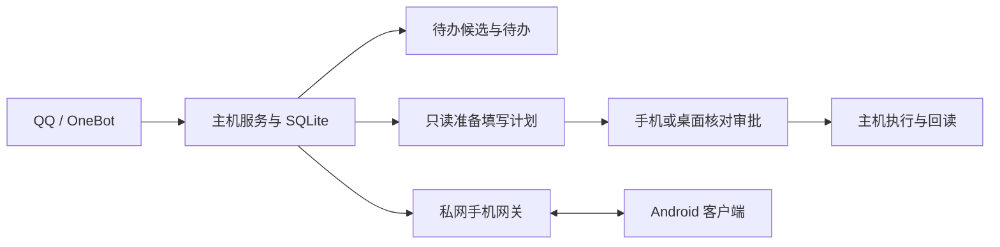

# 课桌 · 校园个人助手

把指定 QQ 来源中的通知整理成待办，并在用户审批后，由电脑后台填写腾讯在线表格。Android 客户端负责查看、补充资料和审批，电脑负责消息处理与文档执行。

当前是面向单用户、单主机的开发原型，主要在 Windows 上验证。Android 版本为 **0.5.0**；金山文档仍处于技术可行性分析阶段，尚未实现读写。

## 功能与范围

| 模块 | 当前能力 |
| --- | --- |
| QQ 消息 | 通过 NapCat / OneBot 接收指定群聊、群成员或好友消息，按稳定账号标识过滤、入库和去重 |
| 待办 | 会话内合并相关消息，生成候选；手机保留/忽略候选，完成、恢复或确认删除正式待办 |
| 附件 | PDF、DOCX 提取文字；图片使用本地 Tesseract OCR；旧式 `.doc` 等不支持格式明确反馈 |
| 腾讯表格 | 读取表格、定位本人行、生成修改计划、补充缺失资料、人工审批、写前复核和写后回读 |
| Android | Kotlin / Compose 原生客户端，Keystore 保存设备令牌，内嵌 Tailscale 私网传输 |
| 桌面 | React / TypeScript 工作台与 Tauri 2 Windows 壳，原生壳使用 Windows Credential Manager |
| 技术早报 | RSS 抓取、DeepSeek 中文摘要、来源链接、手机阅读和可配置定时 |

待办的“保留”和“完成”不会自动批准文档填写。文档执行需要用户核对计划并批准；写入开始后结果不明时进入 `outcome_unknown`，只能先核对，不自动重写。

## 处理流程



主机服务与网关只监听本机回环地址，手机经 Tailscale Serve HTTPS 访问网关。Android 的用户态私网传输不占用系统 `VpnService`；已在一台保留原 VPN 的手机上验证连接，但不据此承诺所有设备和网络环境均兼容。

## 本地开发

### 环境要求

- 后端：Node.js **24+**、npm；真实腾讯表格执行使用已安装的 Microsoft Edge。
- 桌面 Web：根目录和 `desktop/` 各自的 npm 依赖。构建 Tauri 壳另需 Rust MSVC 工具链和 WebView2。
- Android：JDK 21、Android SDK 36；内嵌传输重建另需 Go 工具链及 NDK，版本见构建脚本和 `mobile/tsnet-probe/go/go.mod`。
- 真实业务：自行配置 QQ / NapCat、腾讯文档专用登录会话、本人资料和 DeepSeek API 访问。手机私网连接另需 Tailscale 配置与设备配对。

仓库不包含账号、数据库、浏览器会话、第三方 QQ 适配器安装包或预构建 APK/AAR。当前部分脚本仍带本机工具路径，换机需调整，尚未实现一键部署。

### 安装依赖与检查

在仓库根目录运行：

```powershell
npm ci
npm --prefix desktop ci
npm test
npm run desktop:build
```

前两条按锁文件安装后端和桌面依赖；`npm test` 运行后端测试，最后一条检查桌面 TypeScript 并生成 Web 构建。`npm ci` 会重建对应目录的 `node_modules`，不初始化真实账号，不填写在线表格。

### 配置真实业务后启动

首次使用需完成独立账号和会话配置，参阅 [账号与会话说明](docs/account-switching.md)、[原型初始化记录](docs/poc-implementation.md) 和 [私网配置](docs/private-network.md)。原型记录中的样本昵称、路径和旧状态不是新用户默认配置。

主机配置位于 `.private/config.json`，资料与任务位于 `.private/poc.sqlite`。先确认来源、账号、`pipeline=v2`、`messageCenter=true`，在接入与登录检查期间保持 `execute=false`。DeepSeek 相关功能读取主机进程环境变量 `DEEPSEEK_API_KEY`；仅创建 `.env` 文件不会自动加载它。

源代码仍保留一个开发时的测试表默认地址；新环境应换成自己获授权的测试表，不能把默认地址当作通用演示资源。

```powershell
npm start
```

启动本机 `127.0.0.1:9087` 主服务，窗口需保持打开。它会初始化/迁移本地数据库并按当前配置启动 worker；已有配置可能启用执行并保留获批准的任务，启动前应核对配置与任务，不能把启动当作只读检查。

另开窗口启动桌面开发界面：

```powershell
npm run desktop:dev
```

访问 `http://127.0.0.1:5173`，按界面配置连接。NapCat 和手机网关需要分别准备和启动；查看 [手动启动及交接说明](CODEX_HANDOFF.md)，不要重复启动占用同一端口的实例。

### Android 构建

```powershell
.\tools\build-android.ps1
```

该脚本运行手机端测试、lint 和 debug APK 构建，产物位于 `mobile/android/app/build/outputs/apk/debug/`。换机时用 `-JavaHome`、`-AndroidSdk`、`-GradleCache` 指定工具目录。缺失或过期的 AAR 会触发 Go 桥接库重建；首次需要下载依赖，Gradle 离线模式不代表 Go 依赖已缓存。

完整步骤见 [Android 运行说明](mobile/android/README.md)。当前原生库构建目标为 arm64，debug APK 仅供测试，release 尚未配置正式发布签名。

## 验证结果与已知限制

以下是 **2026-11-03 的历史验证记录**，不代表当前机器上的服务或手机仍在线：

- 后端 140 项、Android 53 项测试，以及 Android debug/release 构建和 lint 通过。
- 真实 QQ 消息接入、部分真实附件提取、腾讯测试表审批写入和回读有历史证据；不同来源和布局的覆盖以对应记录为准。
- Android 正式应用的私网配对、认证读取、跨进程复用，以及合成待办完成/恢复/删除已通过真机验证。
- 合成候选在手机退到桌面后触发通知，用户确认可见；不等于真实 QQ 新消息端到端通知、三类通知或全天后台运行都已验收。

主要限制：

- 通知采用后台轮询。厂商进程清理后自动恢复尚不可靠，长期锁屏、切网和原 VPN 重连仍待验证。
- v2 中断恢复、浏览器会话互斥及复杂表格布局仍有待完善之处；不承诺无人值守的任意表格填写。
- 金山/WPS、飞书只有平台识别预留，尚无已实现的执行器；微信接入未实现。参阅 [金山可行性分析](docs/kdocs-feasibility.md)。
- 技术早报定时需要配置，功能实现不等于已开启每日投递。
- Linux 部署、多用户服务和正式安装分发尚未形成可交付方案。

## 数据与凭据

`.private/` 存放账号配置、个人资料、SQLite、附件、浏览器与私网会话。它与 `.env*`、数据库旁文件、签名文件、日志、安装包和主要构建产物均由 `.gitignore` 排除；依赖锁文件与 Gradle wrapper 保留在源码中。

模型功能会将处理所需的部分内容发送到所配置的 DeepSeek 服务，不能把“本地存储”理解为全部计算离线。图片 OCR 当前在本机执行；字段映射请求包含裁剪后的表头和本人行，具体发送边界见源码与设计。

上传 GitHub 不会备份被忽略的数据库、账号和会话，私人数据应单独保存。准备公开仓库前，还需审查整个 Git 历史、提交作者信息、文档链接和截图，详见 [GitHub 上传说明](docs/github-publishing.md)。

## 目录与文档

```text
src/                    主机 API、任务、消息处理和文档执行
mobile/android/         Android 原生客户端与测试
mobile/tsnet-probe/go/   共享用户态私网桥接库源码
desktop/                Web 工作台和 Tauri 壳
test/                   后端自动测试
tools/                  构建、运行和诊断脚本
docs/                   设计、可行性分析和分阶段验证记录
```

- [项目交接入口](CODEX_HANDOFF.md) / [历史交接](HANDOFF.md)
- [Android 实施](docs/android-implementation.md) / [内嵌私网](docs/embedded-tailscale.md)
- [通知与待办验证](docs/notification-and-todos.md) / [早报验证](docs/verification/2026-11-03-briefing.md)
- [真实 QQ 与腾讯表格验证](docs/verification/2026-10-30.md)
- [需求基线](docs/requirements.md) / [架构](docs/architecture.md) / [后台设计](docs/backend-design.md)
- [最初最小原型范围](docs/minimal-poc.md)：历史基线，不是当前 Android 交付状态。

## 许可证

当前尚未选定项目许可证。上传 GitHub 与选择开源许可证是两件事；公开前应明确本项目的使用授权，并核对所用第三方组件的许可证与分发要求。
