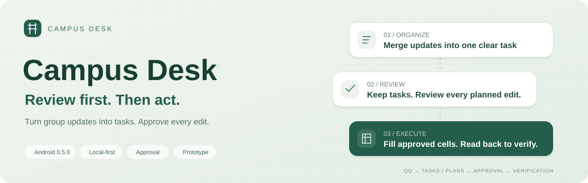
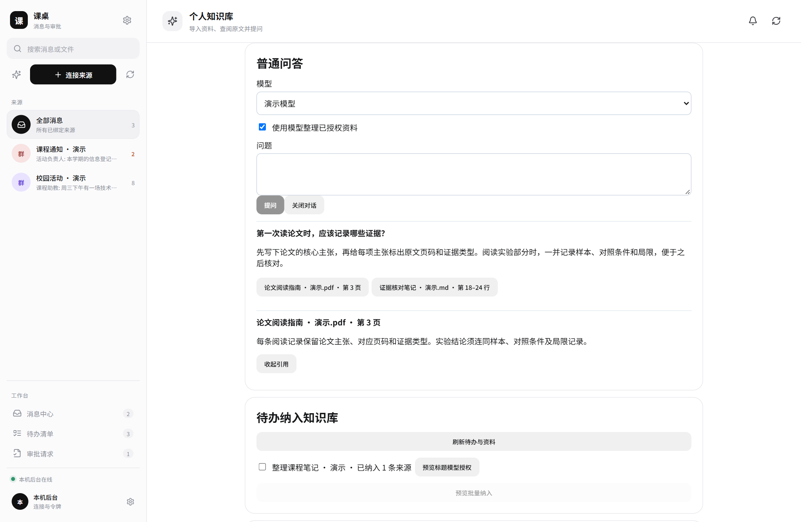
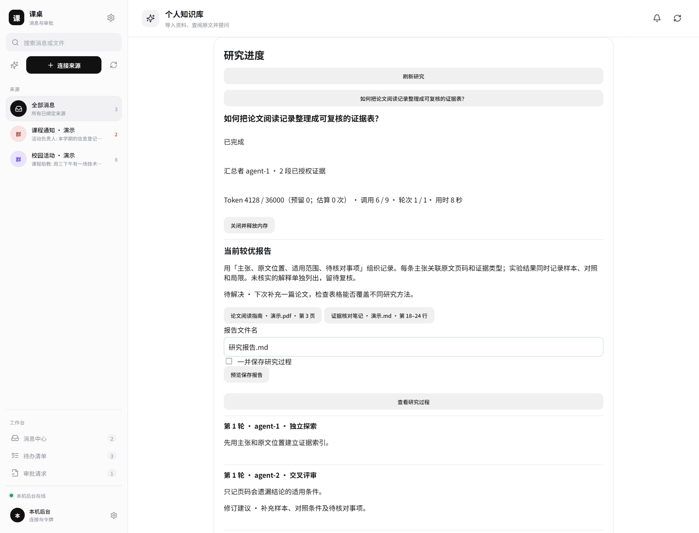
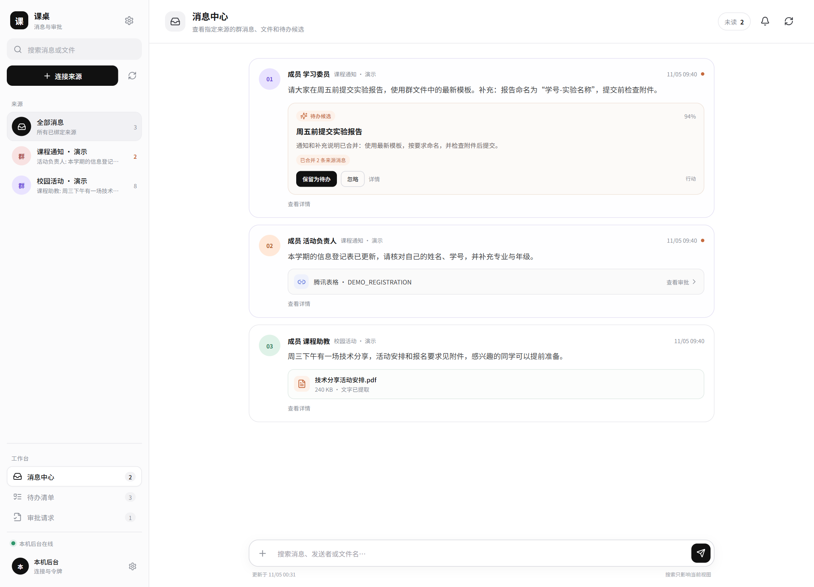
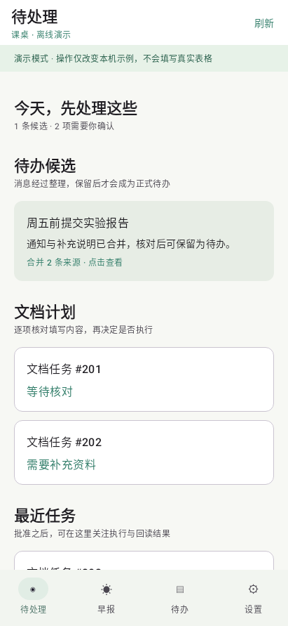
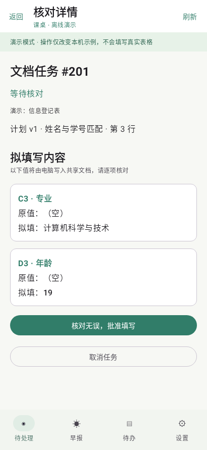
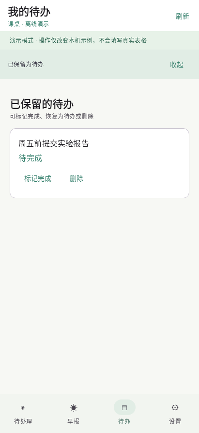
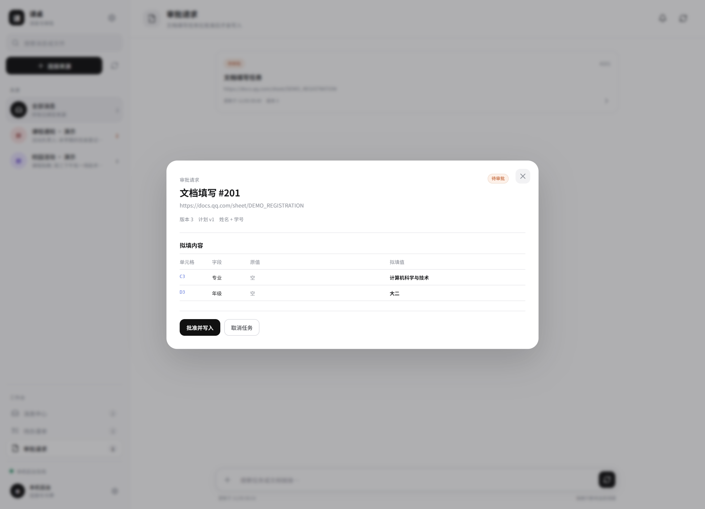
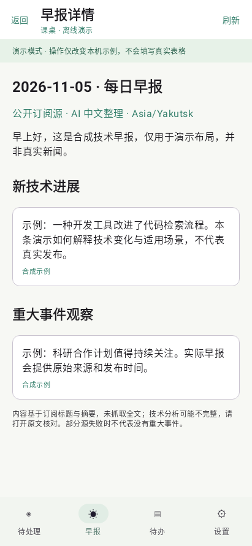
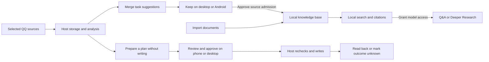

<p align="center">
  
</p>

<p align="center">
  <a href="README.md">简体中文</a> · <strong>English</strong>
</p>

<p align="center">
  <strong>Turn campus updates into tasks and ask questions about your own notes.</strong><br>
  Organize documents and run research on the desktop. Review spreadsheet plans on desktop or Android.
</p>

<p align="center">
  <a href="#preview">Preview</a> ·
  <a href="#features">Features</a> ·
  <a href="#quick-start">Quick Start</a> ·
  <a href="#validation-and-limitations">Limitations</a> ·
  <a href="#project-layout-and-documentation">Documentation</a>
</p>

**Campus Desk** is a personal campus assistant. It turns selected QQ messages into task suggestions and prepares Tencent Docs spreadsheet plans for review on desktop or Android. The desktop also includes a local knowledge base with source citations and a multi-agent **Deeper Research** workspace.

This is a **single-user, single-host development prototype**, primarily validated on Windows. The Android client is at **0.5.0**. KDocs support is still being assessed for technical feasibility.

## Preview

### Desktop knowledge base and Deeper Research

Open citations in a knowledge base answer to check the source excerpt and its page or line.



Deeper Research shows budget usage, the best report so far, and the agents’ review process.



### Organize on your computer. Decide on your phone.

The actual desktop message center brings together original updates, attachments, merged task suggestions, and spreadsheet approval requests.



### Review incoming items, approve a plan, and manage your tasks

<table>
  <tr>
    <th width="33%">Incoming items</th>
    <th width="33%">Spreadsheet approval</th>
    <th width="33%">Personal tasks</th>
  </tr>
  <tr>
    <td></td>
    <td></td>
    <td></td>
  </tr>
  <tr>
    <td align="center">Merge related updates and keep useful tasks</td>
    <td align="center">Review the destination and values before approval</td>
    <td align="center">Complete, reopen, or confirm deletion</td>
  </tr>
</table>

<details>
<summary><strong>Desktop plan review and Android technology briefing</strong></summary>

<br>


<p align="center">
  
</p>

</details>

<sub>The current application UI is in Chinese. All screenshots use synthetic data. Desktop images show the actual React UI; Android images are Robolectric renders of the actual Compose UI, not device captures. These images are not evidence of real-platform writes or background notifications. [Image provenance and reproduction (Chinese)](docs/images/readme/README.md)</sub>

## Features

| Desktop feature | What you can do |
| --- | --- |
| Personal knowledge base | Import Markdown, TXT, DOCX, PDF, PNG, and JPEG. Text extraction and OCR run locally. Open search results at a source excerpt and its page, paragraph, or line. |
| Knowledge Q&A | Ask questions about notes and profile fields. Grant model access to selected material to generate answers with source citations. |
| Tasks and profile | Approve source admission when keeping a task, or admit sources from existing tasks in batches. Completed or deleted tasks leave search. Approved profile changes trigger fresh preparation and approval of affected spreadsheet plans. |
| Deeper Research | Configure two to four agents to explore independently, review each other's findings, revise, and compare results. Set limits for tokens, calls, rounds, and active time. Pause, resume, cancel, or add requirements. |

Research runs in the host process. Reopen the desktop window to check progress. Saving a report requires approval of a write preview, and the host releases unsaved research when it exits.

| Message organization | Personal tasks | Approved spreadsheet edits |
| --- | --- | --- |
| Select QQ groups, members, or contacts; filter by stable account identifiers | Merge updates about the same activity and keep or dismiss suggestions | Read Tencent spreadsheets, locate your row, and prepare cell-level changes |
| Extract PDF and DOCX text; run image OCR locally | Complete, reopen, or confirm deletion on Android | Ask for missing information; show existing and proposed values before approval |
| Preserve original messages and their sources | Read technology briefings with source links and scheduling settings | Recheck before writing and read back afterward; never automatically repeat an uncertain write |

| Component | Technology and responsibilities |
| --- | --- |
| Android | Kotlin / Jetpack Compose; Keystore-encrypted device tokens; review, input, and approval |
| Desktop | React / TypeScript / Vite; Tauri 2 Windows shell with Credential Manager |
| Host | Node.js 24 / SQLite FTS5 / Playwright; message processing, document search, research, and spreadsheet execution |
| Private network | Tailscale Serve HTTPS and Android userspace tsnet; separate application device pairing |
| Models and attachments | Configure Chat Completions compatible models in a local file; PDF / DOCX extraction and local Tesseract OCR for images and scanned pages |

The phone does not operate QQ or the document browser directly. The host service and gateway bind to loopback addresses, and the phone connects over the private network. The embedded Android transport does not use the system `VpnService`; connectivity has been verified on one phone while its existing VPN remained active.

## Workflow



Keeping a task does not approve a spreadsheet edit. If the outcome becomes uncertain after a write begins, the task enters `outcome_unknown`. The system verifies first and does not automatically write again.

## Quick Start

### Requirements

- Backend uses Node.js 24 and npm. The desktop knowledge base is validated on **Node.js 24.22.2 / SQLite 3.53.4**. Real Tencent spreadsheet execution uses an installed Microsoft Edge browser.
- Desktop web: npm dependencies in both the repository root and `desktop/`. Building the Tauri shell also requires the Rust MSVC toolchain and WebView2.
- Android: JDK 21 and Android SDK 36. Rebuilding the embedded transport also requires Go and the NDK; see the build scripts and `mobile/tsnet-probe/go/go.mod` for versions.
- Real use: configure your own QQ / NapCat setup, dedicated Tencent Docs login session, personal profile, and DeepSeek API access. Private phone access additionally requires Tailscale configuration and device pairing.

The repository does not include accounts, databases, browser sessions, third-party QQ adapter installers, or prebuilt APK/AAR files. Some scripts still contain machine-specific tool paths that need adjustment. One-command deployment is not yet available.

### Install dependencies and run checks

From the repository root:

```powershell
npm ci
npm --prefix desktop ci
npm test
npm run desktop:build
```

The first two commands install backend and desktop dependencies from their lockfiles. `npm test` runs backend tests; the final command checks desktop TypeScript and builds the web UI. `npm ci` recreates the corresponding `node_modules` directory. These commands do not configure real accounts or fill online spreadsheets.

### Use desktop knowledge search and research

Prepare the local database, pinned runtime, and documents using the [knowledge base setup and import guide (Chinese)](docs/setup.md#桌面知识库). On a configured Windows host, run the following command to start the local knowledge service. `-CopyDesktopToken` copies the separate connection token for first use.

```powershell
.\tools\start-assistant.ps1 -CopyDesktopToken
```

Keep the service terminal open. Open the knowledge base in the Campus Desk sidebar, paste the token, and connect. Local search is available after import. Approve model access to the material you want to use in model Q&A or research. See the [same guide](docs/setup.md#桌面知识库) for running the QQ and spreadsheet workers alongside the knowledge service.

### Configure real use before starting

First configure your accounts, profile, and dedicated sessions. See the [runtime and connection guide (Chinese)](docs/setup.md).

Host configuration lives in `.private/config.json`; profiles and tasks live in `.private/poc.sqlite`. Check the source and account, use `pipeline=v2` and `messageCenter=true`, and keep `execute=false` during connection and login checks. DeepSeek features read `DEEPSEEK_API_KEY` from the host process environment; creating an `.env` file alone does not load it automatically.

First-run configuration does not include a real spreadsheet address. Set your own authorized test spreadsheet in the local configuration.

```powershell
npm start
```

This starts the host service on `127.0.0.1:9087`; keep the terminal open. It initializes or migrates the local database and starts workers according to the current configuration. An existing installation may have execution enabled and previously approved tasks queued, so check the configuration and tasks before starting. Starting the service is not a read-only inspection.

Open another terminal for the desktop development UI:

```powershell
npm run desktop:dev
```

Open `http://127.0.0.1:5173` and configure the connection. NapCat and the mobile gateway must be prepared and started separately; see the [runtime and connection guide (Chinese)](docs/setup.md). Do not start duplicate instances on occupied ports.

### Build Android

```powershell
.\tools\build-android.ps1
```

The script runs Android tests and lint, then builds a debug APK under `mobile/android/app/build/outputs/apk/debug/`. On another machine, use `-JavaHome`, `-AndroidSdk`, and `-GradleCache` to specify tool directories. A missing or outdated AAR triggers a Go bridge rebuild. The first build requires dependency downloads; Gradle offline mode does not imply Go dependencies are cached.

See the [Android guide (Chinese)](mobile/android/README.md) for details. The current native library targets arm64. The debug APK is for testing; release builds do not yet have a production signing configuration.

## Validation and Limitations

- This is a single-user, single-host Windows development prototype. Spreadsheet execution is implemented for Tencent Docs; KDocs/WPS, Feishu, and WeChat integration are not implemented.
- Deeper Research currently uses authorized knowledge base excerpts. Synthetic runs covered agent collaboration, budget controls, and reconnection. Web evidence gathering and comparisons across effort levels are planned.
- Phone notifications depend on background polling. Recovery after process termination and all-day reliability still need work.
- Complex spreadsheet handling, deployment scope, and recovery capabilities have limits. See [usage limitations and data handling](docs/validation-and-data.en.md).

## Data and Credentials

- Accounts, profiles, attachments, and sessions are stored locally under `.private/` and are not distributed with the source. Supply your own credentials and platform logins.
- OCR for images and scanned pages runs locally. The knowledge base sends relevant excerpts to the selected model after you grant access to a file or folder. Existing message analysis, spreadsheet field mapping, and briefings use their own model configuration.
- GitHub does not back up ignored private data; keep separate backups. See [data and credential details](docs/validation-and-data.en.md#data-and-credentials).

## Project Layout and Documentation

```text
src/                    Host APIs, knowledge base, research, message processing, and spreadsheet execution
mobile/android/         Native Android client and tests
mobile/tsnet-probe/go/   Shared userspace private-network bridge source
desktop/                Web workspace and Tauri shell
test/                   Backend automated tests
tools/                  Build, runtime, and diagnostic scripts
docs/                   Runtime guides, usage limitations, and README images
```

- [Runtime and connection guide (Chinese)](docs/setup.md)
- [Android build and usage (Chinese)](mobile/android/README.md) / [desktop development (Chinese)](desktop/README.md)
- [Usage limitations and data handling](docs/validation-and-data.en.md)
- [Image provenance and reproduction (Chinese)](docs/images/readme/README.md)

## License

This project is licensed under the [MIT License](LICENSE), which permits use, modification, distribution, and commercial use, subject to retaining the required copyright and permission notices. The software is provided as is, without warranty.

Third-party code and dependencies remain subject to their respective licenses. Distributions must comply with the applicable copyright notice and license requirements.
